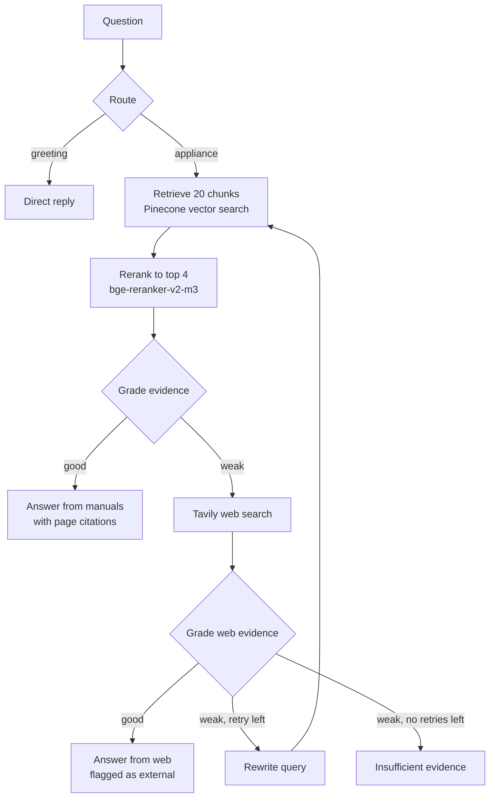

# Appliance Support Agentic RAG Copilot

A support assistant that answers home-appliance questions from **17 official Bosch and Siemens user manuals**,
decides for itself when the manuals are not enough and searches the web instead, and cites the exact manual page
it used. Built with **LangGraph, FastAPI, Pinecone (vector search + reranker), Groq and Tavily**, and measured
with a **62-question evaluation set**: after retrieval and agent improvements, fully correct answers rose from
**57.4% to 78.7%**, wrong answers fell from 4 to **0**, and every answer was judged faithful to its sources.

**Live demo:** https://appliance-support-copilot.onrender.com
(free hosting: after 15 idle minutes the first load takes about a minute; 10 questions per visitor per hour)

Everything runs on free tiers: no OpenAI key or paid service is needed.

---

## What it does

Ask *"My washing machine won't drain, what should I check?"* and the agent:

1. **Routes** the message: appliance question → manuals; greeting → direct reply.
2. **Retrieves** 20 candidate chunks from the manuals in Pinecone and **reranks** them down to the best 4.
3. **Grades** the evidence: is it specific enough, and about the right appliance?
4. If the manuals fall short (recalls, prices, news), **searches the web** with Tavily and grades that too.
5. If both are weak, **rewrites the query** and retries once, otherwise says it could not find reliable evidence.
6. **Answers** only from the evidence, naming the manual, and sends electrical/water repairs to a technician.

The UI shows every decision the agent made and links each citation to the page of the official PDF.



## Knowledge base

17 English user manuals downloaded from Bosch/Siemens' official document server
([`data/appliance_kb/manifest.csv`](data/appliance_kb/manifest.csv) lists each source URL).

| Appliance | Manuals | Brands |
|---|---|---|
| Washing machines | 4 | Bosch |
| Fridge-freezers | 4 | Bosch |
| Induction hobs | 3 | Bosch |
| Dishwashers | 2 | Bosch |
| Ovens | 2 | Bosch, Siemens |
| Tumble dryers | 2 | Siemens |

**Ingestion** ([`app/services/ingestion.py`](app/services/ingestion.py)): 627 English pages → 1,801 chunks.
- Manuals bundle several languages; only English pages are kept (a stop-word ratio test).
- Each chunk is prefixed with its appliance, e.g. `[Bosch dishwasher SHE53B75UC]`, and tagged with brand,
  type, model and page, so retrieval can tell near-identical manuals apart (the Bosch and Siemens ovens share 77% of their text).
- Near-duplicate manuals (>65% shared text) were removed when building the set.

## Tech stack

| Layer | Technology |
|---|---|
| Agent workflow | LangGraph (stateful graph with conditional edges) |
| Answer LLM | Groq `openai/gpt-oss-120b` (writes the final answers) |
| Decision LLM | Groq `openai/gpt-oss-20b` (routing, evidence grading, query rewriting, small talk) |
| Embeddings | Pinecone hosted `multilingual-e5-large` (1024-d) |
| Vector DB + reranker | Pinecone serverless + `bge-reranker-v2-m3` |
| Web search | Tavily |
| API / UI | FastAPI, HTML/CSS/JavaScript |
| Audit log | SQLite (question, path taken, agent trace) |
| Evaluation judge | Groq `qwen/qwen3.8-27b` (a different model from the copilot) |

## Evaluation

[`evaluation/dataset.jsonl`](evaluation/dataset.jsonl) has **62 questions**:
- **47 manual questions:** drafted by an LLM from real manual pages
  ([`generate_candidates.py`](evaluation/generate_candidates.py)), then reviewed by hand and checked
  automatically so that every key fact appears on its source page. Each one records its gold manual and page.
- **10 web questions:** recalls, prices, ownership, news. The manuals can't answer these.
- **5 conversational messages** that need no retrieval.

[`evaluation/run_eval.py`](evaluation/run_eval.py) measures:

| Metric | Meaning |
|---|---|
| Path accuracy | Did the agent use the manuals / the web / a direct reply when it should? |
| Strict hit@k | The gold manual page (±1) is in the top k chunks |
| Content hit@k | A top-k chunk contains the answer's key facts (from any manual; many questions don't name a model) |
| Answer correctness | LLM judge vs the reference answer: correct / partial / incorrect |
| Faithfulness | LLM judge: every claim is supported by the retrieved text |

### Results: baseline vs final

**Baseline:** a standard agentic RAG setup (plain vector search, one model for every step).
**Final:** reranker, model routing, and router/grader prompt fixes (each described below).
Answer quality is scored on the 47 manual questions, which both runs completed; the baseline run stopped at
question 55 of 62 on Groq's daily token limit, so 2 web and 5 conversational questions were not reached.

| Metric | Baseline | Final |
|---|---|---|
| **Answer fully correct** (every key fact present) | 57.4% (27/47) | **78.7% (37/47)** |
| Answer correct or partial | 91.5% | **100%** |
| Wrong answers | 4 | **0** |
| **Faithfulness** (no claims beyond the retrieved text) | 93.6% | **100%** |
| Path accuracy: manual questions | 97.9% (46/47) | **100% (47/47)** |
| Path accuracy: web questions | 75.0% (6/8 run) | **90.0% (9/10)** |
| Path accuracy: conversational | not reached | **100% (5/5)** |
| Right evidence in the top 4 (content hit@4) | 91.5% | **93.6%** |
| Right evidence ranked first (content hit@1) | 68.1% | **78.7%** |
| Average response time | 21.7 s | **8.0 s** |

Per question: 12 answers improved to fully correct, 2 slipped from correct to partial (each omitted one minor detail),
and all 4 previously wrong answers became correct. The baseline response time includes waiting on rate limits,
since every step shared one model's quota; with model routing that waiting mostly disappears.
Answers are graded by an LLM judge (`qwen3.8-27b`, the same for both runs); with 47 questions, one question is about 2 points.

### Retrieval improvement: adding a reranker

All 47 manual questions, top 4 chunks given to the LLM
([`retrieval_experiments.py`](evaluation/retrieval_experiments.py), no LLM tokens used):

| Setup | Content hit@4 | Content hit@1 | Strict hit@1 | Content MRR@10 |
|---|---|---|---|---|
| Vector search (baseline) | 91.5% | 68.1% | 57.4% | 0.782 |
| BM25 keyword search | 87.2% | – | 44.7% | – |
| Hybrid (vector + BM25, RRF) | 89.4% | – | 57.4% | – |
| **Vector top-20 → reranker** (adopted) | **93.6%** | **78.7%** | **66.0%** | **0.858** |

The reranker puts the right evidence **first** far more often (+10.6 pts). Hybrid search did **not**
help on these manuals at k=4, so it was not adopted. With 47 questions, one question is about 2 points.

### Model routing: a smaller model for the agent's decisions

Routing and evidence grading are short yes/no decisions, so they were tested on the smaller `gpt-oss-20b`
with the app's own prompts ([`decision_test.py`](evaluation/decision_test.py)):

| Decision | `gpt-oss-120b` (baseline run) | `gpt-oss-20b` |
|---|---|---|
| Router: manuals vs direct reply | 98.2% (54/55) | 98.4% (61/62), same single miss |
| Grader: "good" on manual questions | 46/47 | 47/47 |
| Grader: "weak" on web questions | 7/7 | 10/10 |

No accuracy was lost, so the decisions now run on `gpt-oss-20b` and `gpt-oss-120b` only writes answers.
Both models misrouted *"price in India"* as small talk; after a router-prompt fix, routing is **62/62 (100%)**,
and 8 extra edge cases (e.g. *"ok"*, *"What can you help me with?"*, *"Hello! My dishwasher is leaking"*) route correctly.
Each Groq model has its own free-tier quota, so the large model's token use per question drops substantially.
(The baseline grader saw vector-search chunks and the 20b test saw reranked chunks, so the grader rows are close but not identical comparisons.)
The grader prompt was also adjusted so that, when a question names only the appliance type, evidence from any manual of
that type counts; in the final run every manual question was graded "good".

## Setup

**1. Install** (Python 3.10+)

```bash
git clone https://github.com/Bhavya934/appliance-support-agentic-rag.git
cd appliance-support-agentic-rag
python -m venv venv
venv\Scripts\activate          # macOS/Linux: source venv/bin/activate
pip install -r requirements.txt
```

**2. Add free API keys:** copy `.env.example` to `.env` and fill in:

| Key | Where | Cost |
|---|---|---|
| `GROQ_API_KEY` | console.groq.com | Free tier |
| `PINECONE_API_KEY` | app.pinecone.io | Free Starter plan |
| `TAVILY_API_KEY` | app.tavily.com | Free, 1,000 searches/month |

**3. Download the manuals and build the index**

```bash
python download_manuals.py   # ~60 MB of PDFs from Bosch/Siemens' document server
python ingest_kb.py          # creates the Pinecone index and uploads 1,801 chunks
```

**4. Run**

```bash
python run.py                # http://127.0.0.1:8080  (API docs at /docs)
```

**5. Evaluate**

```bash
python -m evaluation.run_eval --retrieval-only --tag test   # retrieval only, no LLM tokens
python -m evaluation.run_eval --tag full                    # full run (~200K Groq tokens)
python -m evaluation.run_eval --resume evaluation/results/<file>.jsonl   # continue after a rate limit
python -m evaluation.decision_test --model openai/gpt-oss-20b          # test routing + grading with any model
```

**6. Deploy** (Render, free plan, Docker)

[`render.yaml`](render.yaml) describes the service. On [render.com](https://render.com):
**New → Blueprint →** pick this repository, then enter `GROQ_API_KEY`, `PINECONE_API_KEY` and `TAVILY_API_KEY`
when asked. Every push to `main` redeploys automatically.

The service runs with `PUBLIC_DEMO=true`: document upload is off, each visitor gets 10 questions per hour,
and the demo stops at 60 questions per day to stay inside the free API quotas. The container runs as a
non-root user, uses about 100 MB of memory, and needs no PDFs, because answers come from the Pinecone index.
On the free plan the service sleeps after 15 minutes without visitors; the first request after that takes about a minute.

## Project structure

```text
app/
  api/routes.py          chat, health and document-upload endpoints
  core/config.py         settings loaded from .env
  rag/workflow.py        LangGraph agent: route → retrieve → grade → web → rewrite → answer
  rag/vectorstore.py     Pinecone index, embeddings, retrieval + reranking
  rag/hybrid.py          BM25 + reciprocal rank fusion (used in experiments)
  services/ingestion.py  PDF loading, English-page filter, chunking, appliance labels
  services/audit.py      SQLite audit log
  services/rate_limit.py per-visitor and daily limits for the public demo
data/appliance_kb/       manifest.csv (PDFs are downloaded, not committed)
evaluation/              dataset, generator, runner, judge, retrieval experiments, results
templates/, static/      web UI
download_manuals.py      fetches the manuals listed in the manifest
ingest_kb.py             chunks, embeds and uploads the manuals in rate-limit-safe batches
render.yaml              Render deployment (public-demo mode)
```

## Engineering highlights

- **Real-world knowledge base:** 17 official appliance manuals (1,801 chunks) selected from 26 candidates by removing
  near-duplicates, with multilingual-page filtering, appliance-labelled chunks and per-chunk metadata.
- **Measured retrieval choices:** 5 retrieval setups compared on the evaluation set; the reranker was adopted and
  hybrid search rejected on the evidence.
- **Model routing:** routing and grading run on `gpt-oss-20b`, answers on `gpt-oss-120b`, after testing that the
  decisions stay as accurate; this spreads load across free-tier quotas and cut response time.
- **Evaluation-driven fixes:** a 62-question dataset with LLM-as-judge scoring, retrieval and decision tests, and
  resumable runs; failures it exposed (misrouted price questions, an over-strict grader) were fixed and re-measured.
- **Production touches:** free-tier rate-limit handling, page-level citation links to the official PDFs, a public-demo
  mode with per-visitor limits, a non-root Docker image, and a dependency status check for deployments.

## License

Apache-2.0. See [LICENSE](LICENSE).
